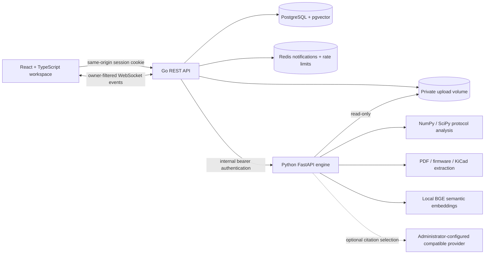

# Architecture

BenchTrace is an investigation workspace, not a general-purpose chatbot.

## Ownership and trust boundaries

The Go API owns sessions, project access, relational persistence and job lifecycle. Every project route verifies the session owner before reading or changing records. The engine is internal-only and additionally requires an independent bearer secret. Browser clients cannot choose storage paths or provider URLs. Binary files are stored outside the database, named by generated UUIDs, with SHA-256 provenance. No uploaded firmware is compiled or executed.

The Python service performs bounded analysis, returning structured facts and limitations. Uploaded text is untrusted evidence. The default RAG answer is extractive: source excerpts, document identity and page references. An optional provider may select existing citation IDs; invalid IDs and free-form claims are discarded. Physical conclusions require explicit user-recorded tests and retain that attribution.

## Job model

PostgreSQL is the durable queue. Workers claim jobs using `FOR UPDATE SKIP LOCKED`, mark processing state, call the engine with a 90-second timeout, then commit analysis and metadata atomically. Redis carries completion notifications and authentication rate limits. WebSocket subscriptions filter each event through project ownership. Polling refresh is available in the UI if socket delivery is interrupted. Stale processing jobs are eligible for recovery; failed analyses are visible and can be requeued through decoder configuration. The initial deployment runs one worker in the API process.

## Evidence and diagnosis

- Arduino C/C++: comment-aware pattern extraction, macro resolution for integer literals, source line locations. No arbitrary program execution, complete C++ AST, control-flow or timing proof.
- KiCad `.kicad_sch`: top-level symbols, embedded pins, root-sheet orthogonal wires, labels and pin-to-net connectivity for unmirrored symbols with right-angle rotations. Wires connect where endpoints, symbol pins, labels, or explicit junctions meet; interior crossings without one remain separate. `.net`: exported S-expression components, pins and connectivity; preferred for authoritative graph imports. Hierarchical sheets, buses, mirrored symbols, diagonal wires and non-right-angle transforms are unsupported. No inferred electrical behavior or physical continuity.
- PDF: extracted text with pages; no OCR. Text/JSON: cited source content.
- CSV: strictly increasing seconds, finite numerical channels, maximum 200000 samples. Voltage threshold defaults to 1.65 V and is configurable.
- I2C: sampled START/STOP, 7-bit and 10-bit address phases, repeated-start 10-bit reads when the matching acknowledged write-address phase is present, data bytes, ACK/NACK and incomplete capture warnings. UART: configurable baud, 8N1. SPI: configurable CPOL/CPHA, active-low CS, MSB-first 8-bit MOSI.
- Ranking: distinct supporting sources minus contradicting sources. User observations are explicitly labeled. This is an evidence ordering rule, not a probability or calibration claim.

Semantic vectors are 384-dimensional BGE-small English embeddings, produced locally through FastEmbed. Never mix lexical and semantic vectors in one database. A lexical mode exists for offline unit tests, not as an automatic production fallback. Retrieval is restricted by project ownership before returned evidence is rendered.

## Sources used for implementation boundaries

- [NXP I2C specification](https://cache.nxp.com/docs/en/user-guide/UM10204.pdf): data validity, START/STOP and ACK structure. Sampling checks are BenchTrace heuristics, not a compliance certification.
- [KiCad schematic file format](https://dev-docs.kicad.org/en/file-formats/sexpr-schematic/) and [S-expression coordinates](https://dev-docs.kicad.org/en/file-formats/sexpr-intro/): symbol pins, wire points, labels, junctions and schematic coordinate conventions.
- [Docker Compose merge behavior](https://docs.docker.com/reference/compose-file/merge/): the published-image overlay clears local `build` entries with `!reset` while retaining the shared service configuration.
- [FastEmbed supported models](https://qdrant.github.io/fastembed/examples/Supported_Models/): local BGE model and embedding dimensionality.
- [FastAPI container guidance](https://fastapi.tiangolo.com/deployment/docker/): dedicated Python service image.

## Deployment boundaries

Compose exposes only nginx on loopback port 8080. Databases, Redis and the engine have no host ports. Public deployment requires HTTPS termination, an exact APP_ORIGIN, secure cookies, backups, resource monitoring and an operator-managed release process. See SECURITY.md and ROADMAP.md for remaining limitations; local container success is not evidence of a public production deployment.

The embedding artifact is pinned by repository revision and SHA-256 hashes in `ai-engine/model.lock.json`. Image builds verify each file; runtime uses the baked local model without network downloads. Embedding identities travel with vectors and prevent cross-version comparisons. Update the lock, runtime identity, and compatibility tests together when changing models.
