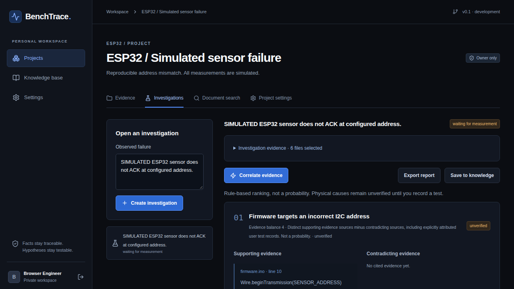
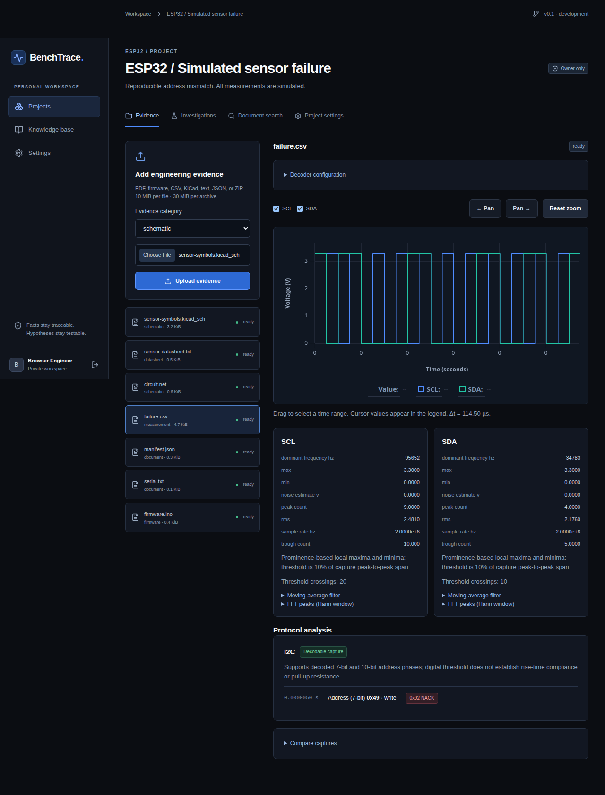
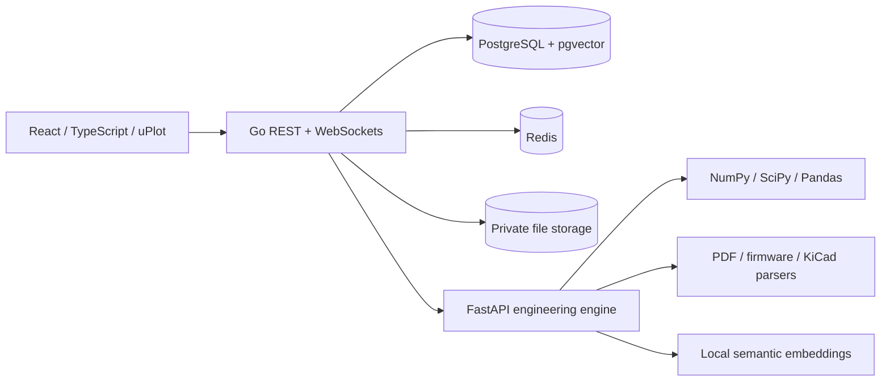

# BenchTrace

**Don’t just debug your hardware. Understand why it fails.**

BenchTrace is an open-source investigation workspace for hardware and embedded firmware failures. It connects source code, circuit connectivity, component documentation, and measured signals so an engineer can evaluate competing causes and choose a verification test.

**Stable release for the documented initial scope.** The explicit Definition of Done checks are verified for the supported formats and ESP32/Arduino I2C workflow; this does not claim complete C++ or KiCad coverage, physical hardware validation, or a hosted public service. See the [requirement audit](docs/REQUIREMENTS.md), [executed milestones](ROADMAP.md), and [v0.1.9 GitHub release](https://github.com/pragyan43jain/benchtrace/releases/tag/v0.1.9). v0.1.9 includes a source-grounded TMP102 demonstration; the captures and circuit remain simulated.

The deterministic fixed-scenario diagnostic evaluation and its limits are documented in [ai-engine/evaluation](ai-engine/evaluation/README.md); GitHub CI runs it with the engine tests.

## What it does

- Keeps private projects, files, investigations, observations and reports in a persistent workspace.
- Extracts PDF/text evidence with page references and searches it using a local semantic embedding model and pgvector.
- Analyzes sampled CSV waveforms: voltage statistics, sampling quality, prominence-based peak and trough counts, FFT, noise estimates and bounded I2C/UART/SPI decoding.
- Finds recognizable Arduino firmware configuration and imports KiCad netlists plus supported root-sheet schematic wires, labels, X/Y-mirrored symbol pins, and pin-to-net relationships.
- Ranks competing hypotheses using a documented evidence rule, with supporting sources, contradictions, unknowns and confirm/reject experiments.
- Records user-performed tests, preserves investigation history, exports Markdown reports and saves reusable knowledge.

There are no fabricated measurements or confidence percentages. Decoding a NACK does not establish a missing pull-up resistor. Uploaded schematics do not prove physical continuity. A user-confirmed result retains its attribution.

## Actual application screenshots





These screenshots come from automated browser tests against the running application. The displayed engineering data is explicitly simulated.

## Architecture



Frontend: React, TypeScript, Vite, Tailwind, source-owned shadcn-style Radix components, Lucide, Recharts and uPlot. Backend: Go, PostgreSQL/pgvector and Redis. Engine: Python, FastAPI, Pydantic, NumPy, SciPy, Pandas, pypdf, pypdfium2, Tesseract and FastEmbed. Infrastructure: Docker Compose and GitHub Actions. See [ARCHITECTURE.md](ARCHITECTURE.md), [API.md](API.md), and [DATABASE.md](DATABASE.md).

## Run locally

Prerequisites: Docker Engine with Compose, Python 3 for generating local secrets, an internet connection for the initial image/model download, and several GiB of free disk space. No LLM API key is required for local retrieval and diagnostics. A deployment administrator can configure the compatible provider endpoint; each account can then save its own model and encrypted API key in Settings.

```sh
git clone https://github.com/pragyan43jain/benchtrace.git
cd benchtrace
python3 scripts/setup-env.py
docker compose build
docker compose up -d
```

Open **http://localhost:8080**, create an account, and create a project. The setup script generates independent secrets, including the provider-key encryption key, in a git-ignored, owner-readable `.env`; it preserves existing valid values. Uploads and database records persist in named volumes. `docker compose down` stops services without deleting data; adding `-v` destroys the volumes.

Only the web service is published, on loopback. For a public deployment, configure HTTPS termination, the exact `APP_ORIGIN`, `COOKIE_SECURE=true`, backups and operational monitoring. Read [SECURITY.md](SECURITY.md). No public production instance is claimed.

To run the published stable release instead of building from source, use Docker Compose V2 with support for the `!reset` merge tag, set `BENCHTRACE_VERSION` to `v0.1.9`, and use the published-image overlay:

```sh
BENCHTRACE_VERSION=v0.1.9 docker compose -f compose.yaml -f compose.published.yaml pull
BENCHTRACE_VERSION=v0.1.9 docker compose -f compose.yaml -f compose.published.yaml up -d
```

## Reproduce the ESP32 I2C failure

```sh
python3 -m pip install -r demo/requirements.txt
python3 demo/generate.py
```

1. Create an ESP32 project and upload `demo/esp32-i2c/initial-evidence.zip` using automatic categories.
2. Upload `sensor-symbols.kicad_sch` with category **schematic** to see embedded pin metadata and its drawn pin-to-label connections; use the `.net` fixture for assumed full-project connectivity.
3. Upload `sensor-datasheet.txt` from the same directory with category **datasheet**.
4. Inspect the processed `failure.csv`: unsupported TMP102 target `0x4C`, address-byte NACK. The source-cited TI address table and assumed ADD0-to-GND netlist point to `0x48`.
5. Open an investigation and correlate evidence. The firmware address differs from the model’s documented `0x48` address.
6. Perform the proposed simulated verification using `verification.csv`, record the actual result as **simulated**, and export the report.

The TMP102 address facts are attributed to TI datasheet SBOS397I, Table 6-4. The circuit netlist, bus captures, and serial output are simulated, not physical measurements. See [demo/README.md](demo/README.md) for source citations, assumptions, and limitations.

## Supported inputs

| Input | Supported behavior |
|---|---|
| PDF, TXT, JSON | Text extraction, page citations and semantic retrieval; English OCR for up to six scan-only pages per PDF. OCR excerpts are marked unverified and must be checked against the page image |
| CSV | `time` in seconds, finite numeric channel values in volts, strictly increasing samples |
| C/C++/INO/H/HPP | Bounded Arduino `Wire` and ESP-IDF designated I2C configuration analysis; no compilation/execution |
| KiCad `.net` | Exported S-expression components, pins and net connectivity |
| KiCad `.kicad_sch` | Component properties, embedded pin metadata, root-sheet orthogonal wire geometry, labels, single-axis X/Y mirroring with right-angle rotations, and supported pin-to-net connections; unsupported transforms and hierarchy are disclosed, exported `.net` is recommended for authoritative connectivity |
| ZIP | Safe bounded import of supported files; no nested archives or links |

CSV channel names: `scl,sda` for I2C; `rx` for UART; `clk,mosi,cs` for SPI. Threshold, UART baud, CPOL and CPHA are configurable. Decoders report sampling limitations. I2C supports seven-bit addresses and ten-bit address phases, including repeated-start reads when the capture includes the matching acknowledged write-address phase. UART is non-inverted 8N1; SPI is active-low-CS/MSB-first/eight-bit MOSI.

Limits: 10 MiB per file, 30 MiB per upload/extracted archive, 100 ZIP entries, 200000 samples and 16 waveform channels. Unsupported or invalid inputs fail visibly.

## Optional provider

The default workflow runs locally. Administrators can set `LLM_BASE_URL`, `LLM_MODEL` and `LLM_API_KEY` for a compatible chat-completions provider, then recreate the engine service. Settings includes **Test provider connection**; it sends only a fixed synthetic citation marker, never project files, and is limited to three checks per account per minute. Retrieved excerpts will be sent to the configured provider for citation selection. Returned IDs must refer to existing evidence; the provider cannot insert technical claims or new measurements. Never put provider credentials in frontend code.

## Development and verification

```sh
(cd backend && go test -race ./... && go vet ./...)
(cd frontend && npm ci && npm run build && npm test)
docker compose run --rm --no-deps engine python -m pytest -q -p no:cacheprovider
python3 scripts/integration.py
python3 scripts/security-check.py
(cd frontend && npx playwright install chromium && npm run test:e2e)
```

Integration and browser tests create uniquely named test accounts/projects. Use a test deployment. For installed Chrome, run browser tests with `CHROME_PATH=/usr/bin/google-chrome`. Actual results and remaining gates are recorded in [ROADMAP.md](ROADMAP.md); evaluation scope is in [docs/EVALUATION.md](docs/EVALUATION.md).

Contributions should include reproducible evidence and tests: [CONTRIBUTING.md](CONTRIBUTING.md). Licensed under [MIT](LICENSE).

## Recovery and service readiness

See [operations](docs/OPERATIONS.md) for consistent backups, isolated restore and dependency monitoring, and [physical validation](docs/HARDWARE-VALIDATION.md) for the still-unverified hardware evaluation procedure. UART/SPI investigations now provide bounded capture-quality hypotheses when selected decoder evidence is available; they do not establish general electrical root causes.
